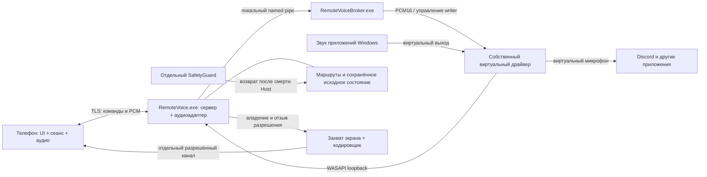
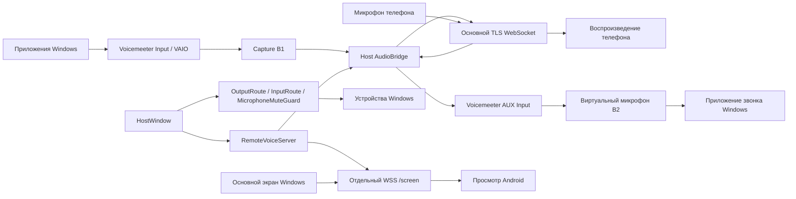
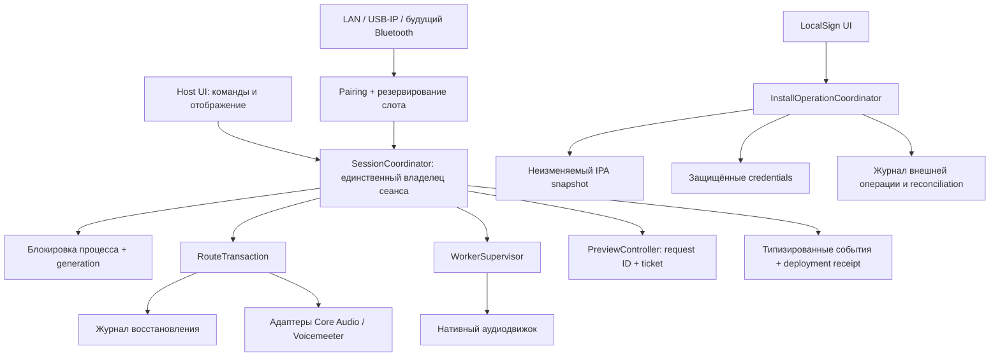
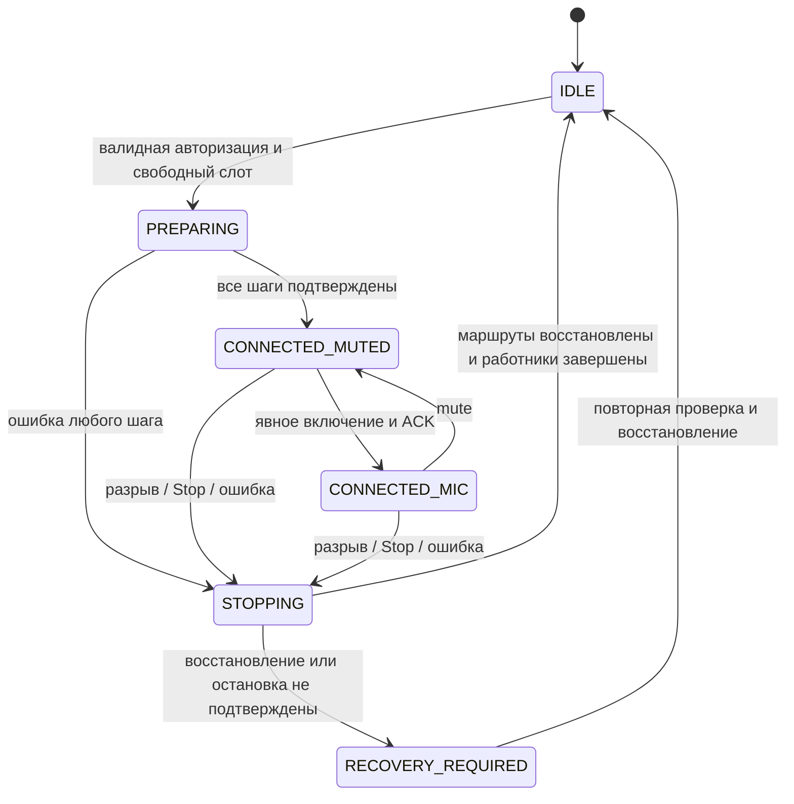

# Единая архитектура RemoteVoice

## Актуальная карта компонентов — 26 октября 2026

Это основной срез архитектуры. Нижележащие версионные разделы сохраняют историю и не подтверждают готовность текущей сборки. Спецификация — [SPEC.md](SPEC.md), последовательность — [ROADMAP.md](ROADMAP.md), методика — [TESTING-PLAN.md](TESTING-PLAN.md).

| Слой | Реализация и ответственность | Состояние |
| --- | --- | --- |
| Android | Java; `MainActivity` — интерфейс, `BridgeService` — сеанс, `PhoneAudioEngine` — запись/воспроизведение, `BridgeConnection` — аудио и команды | Рабочий клиент 0.1.25; длительная приёмка и часть физических сценариев открыты |
| iPhone | Нативный iOS-клиент в `ios/`, тот же аудиопротокол | Установка/подпись и текущая проверка на устройстве не приняты; отдельная ветка после основного тракта |
| Сеть | TLS WebSocket, QR-сопряжение и закреплённый сертификат; команды и PCM в аудиосеансе, отдельное соединение просмотра | Локальная сеть; другие IP-интерфейсы требуют отдельной проверки, Bluetooth не реализован |
| Windows Host | Python, Tk/ttk, asyncio; сервер входит в `RemoteVoice.exe`, UI получает состояния через очередь | Рабочая версия 0.1.22 использует Voicemeeter |
| Аудиоадаптер | `AudioBackend`, legacy `AudioBridge`; новый `DriverBackendRuntime` и `DriverAudioBridge` | Новый вариант связан в исходниках и доступен через лабораторный режим |
| Broker | `RemoteVoiceBroker.exe`, локальный named pipe, проверка процесса/токена/файлов; `MicBroker` управляет writer | Пакет 011 собран; защищённая положительная приёмка вместе с драйвером открыта |
| Виртуальный драйвер | `host/driver`: виртуальные render/capture устройства, ограниченный PCM-канал; `DriverMicWriter` переводит float32 в PCM16 | Прототип отдельно проверялся в прежней Delo; новая сквозная проверка приложения не выполнена |
| Восстановление | Транзакция маршрутов, сохранённое исходное состояние, отдельный `SafetyGuard`, restore-only запись нового backend | Существующий тракт имеет физические проверки; новый тракт требует собственной физической приёмки |
| Экран | Захват Windows → FFmpeg H.264 либо JPEG → отдельный экранный транспорт → Android decoder/TextureView | Функция существует; качество, плавность и совместная нагрузка требуют актуальной приёмки |

Схема показывает целевой собственный аудиотракт; в работающем Host его роль пока выполняет Voicemeeter. Системный звук захватывается через loopback, а голос телефона поступает в виртуальный микрофон через broker. Голос не должен возвращаться в поток системного звука.

**Один пользовательский запуск не означает один процесс.** Цель — один ярлык и одно окно RemoteVoice. Сервер находится внутри Host; broker, guard и кодировщик являются внутренними компонентами без отдельного пользовательского окна/значка. Guard уже выделен для восстановления при смерти Host. Доставка, права и автоматический запуск нового broker ещё не завершены. Драйвер устанавливается компонентом продукта; способ подписанной поставки остаётся отдельным этапом.

### Контракты и владение

- Аудиопротокол: 48 кГц, кадр 480 сэмплов / 10 мс, float32 little-endian; голос mono, системный звук stereo. Это размер пакета, а не обещание сквозной задержки 10 мс.
- Host владеет сервером, маршрутизацией и разрешением просмотра. Телефонный сеанс не может самовольно менять защищённые параметры Windows.
- Runtime удерживает одно подтверждённое соединение с broker между телефонными сеансами. Телефон получает исключительную временную lease; её завершение подтверждает mute перед повторным подключением.
- Broker проверяет действительную Windows-идентичность и защищённую установку, принимает только ограниченный протокол. ACK означает принятую команду; готовность микрофона подтверждается наблюдаемым состоянием writer.
- Все флаги ответа broker берутся из одного снимка. Незавершённая очистка сохраняет владельца ресурса и запрещает его бесконтрольное повторное создание.
- Перед изменением устройств сохраняются все управляемые роли вывода/ввода и исходный mute. При ошибке возврат начинается до ожидания завершения аудиопотоков. Ручной mute до подключения сохраняется.
- При смерти Host восстановление выполняет guard; при штатной остановке порядок возврата координируется с Host. Чтение UI не продлевает жизнь устаревшему статусу.
- Просмотр требует разрешения Host и одноразового билета, привязанного к аудиосеансу. Остановка, фон, отключение и отзыв очищают поверхности; управление мышью/клавиатурой в эту функцию не входит.

### Состояния сеанса

`Отключено → Подготовка → Подключено, микрофон выключен → Микрофон включён`.
Из любого активного состояния ошибка переводит систему в `Восстановление → Отключено` либо в явное `Восстановление не завершено`. Повторный вход разрешается только после проверки оставшихся ресурсов. Просмотр экрана — независимое подчинённое состояние, его сбой не должен блокировать аудио.

## Архитектурные записи предыдущих этапов

## Обязательная целевая Windows-архитектура

В текущих исходниках HostWindow использует `prepare_audio_backend` и `AudioBackend.is_available`, сохраняя прежние route/guard транзакции. Legacy-adapter продолжает использовать Banana; generic pair adapter не запускает микшер. Отдельный `host/native_audio` — собранный in-process прототип PCM-очередей, не Windows-драйвер и не загруженная часть рабочего EXE. Эти изменения ещё не развёрнуты в пользовательском сеансе.

Публичная версия должна выполнять REQ-037/REQ-038: одно приложение RemoteVoice без обязательного отдельного Voicemeeter, включая его значок в трее. Текущий mixer-backend остаётся прототипом до проверенной замены. Контракт, миграция и приёмка описаны в [WINDOWS-AUDIO-INTEGRATION.md](WINDOWS-AUDIO-INTEGRATION.md); замена ещё не реализована.

## Текущая пара Windows 0.1.22 / Android 0.1.25

Android 0.1.24/0.1.25 дополняет debug-диагностику скалярными интервалами на входе бинарного WebSocket callback и временем обработки текущего/предыдущего кадра. В release флаг выключен и измеритель не создаётся. В сообщении нет PCM, адресов или токенов; вывод ограничен одним событием в секунду. Обычная пауза доставки отделена от длительной обработки кадра, но время до callback включает сеть и планирование потока, поэтому не доказывает конкретную причину. Debug-проба 0.1.25 поддерживает ограниченную продолжительность фона и strict_audio: любой ненулевой underrun/drop/rebuffer проваливает такой прогон.

Экранный callback сетевого потока кладёт только последний статус с поколением сервера в mailbox под короткой блокировкой. Tk main thread забирает его каждые 25 мс, устаревшие поколения и события закрытого окна отбрасываются. Синхронный cross-thread Tk.after здесь исключён: при занятом UI он задерживал сетевую передачу аудио. В нативной скрытой пробе ожидание старого пути составило 300,716 мс, публикация в очередь — 0,011 мс. Scalar timing разделяет захват, подготовку/dispatch, ожидание send-lock и отправку; лог ограничен одним выбросом в секунду, изображения и PCM не сохраняются. Буферизация звука и сетевые таймауты этим исправлением не менялись.

Сервер, контроль маршрутов, запуск установленного микшера и ограниченный H.264-процесс управляются Windows-приложением. Android согласует H.264 только с поддерживающим Host, иначе остаётся JPEG. Отсутствующий FFmpeg не вызывает установки: Host не объявляет видеорежим. Содержимое экрана передаётся только по владельцем разрешённому одноразовому билету.

MainActivity связывает ScreenConnection с H264Decoder и одним ZoomVideoView/TextureView. SurfaceTexture удерживается при переносе между inline и fullscreen; размеры и жесты используют существующий ScreenViewport. Закрытие, Home, остановка Activity, разрыв и отзыв сразу скрывают поверхность и отменяют транспорт. Surface освобождается после подтверждённого codec.release, UI не ждёт native IPC. Неизвестный исход освобождения сохраняет блокировку нового декодера и изолирует его поверхность. Пятисекундный watchdog отслеживает отсутствие прогресса декодирования.

Измеренный GDI HALFTONE занимал медиану 55,437 мс, COLORONCOLOR — 32,267 мс, native-размер с последующим bilinear — 62,289 мс. Измерение выполнялось под действующим экранным разрешением, без сохранения пикселей. В 0.1.20 быстрый COLORONCOLOR применяется только к H.264, качественный режим JPEG сохраняется. Он удаляет промежуточные пиксели и может менять вид мелкого текста; итоговая визуальная оценка остаётся обязательной. [Контракт режимов GDI](https://learn.microsoft.com/en-us/windows/win32/api/wingdi/nf-wingdi-setstretchbltmode).

Синтетический debug-probe проверяет два цикла по 90 кадров, настоящий pinch, поворот, сохранение поверхности и очистку. Тестовые Activity, instrumentation и fixture находятся только в src/debug. Кодеки, реальные пиксели и PCM не попадают в журналы. Нижеследующий раздел H.264 сохраняет предыдущий срез до интеграции отображения; его default-off и MainActivity/JPEG относятся к тому срезу.

## Исторический срез H.264 до интеграции отображения

Дополнительно согласование `screen_video` проведено через auth/auth_ok и одноразовый запрос до `BridgeService.ScreenOffer.video`. Host подтверждает его только при включённом эксперименте, `screen_detail` и явном запросе клиента. Android выбирает видео только после подтверждения Host, иначе остаётся на detail/JPEG; неподготовленный старый наблюдатель получает ошибку просмотра вместо видеобилета. Обычный конструктор BridgeConnection оставляет видео выключенным до интеграции отображения. Таким образом MainActivity не переключается на неподдерживаемый режим.

Рабочая установка остаётся Host 0.1.18 / Android 0.1.20. Сервер входит в EXE, установленный Voicemeeter Banana запускается самим Host; отдельный ручной запуск сервера или микшера не требуется. Видеокодировщик тоже принадлежит Host и должен запускаться только на время разрешённого просмотра. Распространение приложения с кодировщиком и первоначальная установка аудиодрайвера остаются отдельными задачами выпуска.

В исходниках экспериментальный H.264 теперь получает RGB из существующего `capture_primary_image`, с SRCCOPY и общей с JPEG блокировкой native-захвата. FFmpeg больше не захватывает рабочий стол через gdigrab: он только кодирует ограниченный сырой поток stdin. Кадры вписываются без растяжения в 1280×800. Один producer и очередь из двух access units ограничивают память; медленный получатель создаёт обратное давление в каналах. Чтение stdout через read1 не ждёт заполнения буфера на неподвижной сцене. Абсолютный темп захвата уменьшает накопление задержки таймера Windows.

Android `ScreenConnection` умеет явно выбранный H.264-профиль и прежний JPEG. Числовые поля разрешены только в парсере отдельного экранного канала; формат аудиоуправления сохраняется строгим. До передачи кадра потребителю проверяются SPS/PPS, первый IDR, размеры и лимит сообщения. Следующий access unit запрашивается после принятия предыдущего декодером, а JPEG — после отображения.

Проверены 389 Python-тестов, 93 Android unit-теста и lint. Синтетический RGB → производственная команда FFmpeg → H.264 → FFmpeg-декодер передал все 60 кадров за 2,463 с, без сохранения изображений. Это не измерение телефона или native-захвата. Отзыв разрешения, сбой запуска, блокировка отправки, отключение аудиосеанса и авария родителя покрыты проверками. Неизвестный исход очистки закрывает допуск нового просмотра, сохраняя аудиосеанс.

H.264 по умолчанию выключен. `MainActivity` ещё использует JPEG: необходимо связать согласование профиля, `H264Decoder` и TextureView с полным экраном и зумом, затем проверить на телефоне совместно со звуком. Новые исходники не устанавливались; отсутствие мерцания курсора и плавность нового видео на телефоне не подтверждены.

## Windows 0.1.18: владение процессами и восстановление

Текущий Windows Host — одно desktop-приложение: WSS-сервер и аудиопотоки находятся внутри `RemoteVoice.exe`. Обычный ярлык запускает его с `--autostart`; сервер не принадлежит чату или терминалу. Для запуска из инструментов используется desktop-объект Explorer (`host/Start-RemoteVoice.ps1`), а не новый внутрипроцессный `Shell.Application`. Приёмка закрыла отдельную kill-on-close группу запуска и подтвердила живые Host, listener и guard вне этой группы.

Сопряжение, конфигурация и TLS-идентичность хранятся в собственном Roaming-профиле RemoteVoice. У первоначального запуска через Codex MSIX путь был перенаправлен в LocalCache пакета; обнаружено через `GetFinalPathNameByHandleW`. Файлы скопированы в обычный профиль с проверкой хэшей и сохранением прежних данных. При диагностике из Codex нельзя принимать его перенаправленный `runtime.json` за текущее состояние desktop-приложения: `host/Desktop-State.ps1` получает только runtime/guard/shortcut-метаданные в контексте Explorer, без ключей и токена.

Установленный Voicemeeter Banana — зависимость аудиотракта, которую Host запускает через Remote API и проверяет до переключения устройств. Живой Host также проверяет доступность микшера: одних виртуальных endpoint и поступающих нулевых PCM недостаточно для признания сеанса здоровым. При потере микшера начинается остановка с возвратом всех ролей Windows. При потере сети срабатывает контроль WebSocket, при смерти Host — отдельный guard, который читает журнал из того же собственного профиля. Ручной mute сохраняется.

GDI JPEG-захват теперь использует `SRCCOPY` без `CAPTUREBLT`; визуальная проверка курсора остаётся открытой. Экспериментальный H.264-контур по умолчанию выключен до подключения декодера/UI Android и физической приёмки. Детальные исторические срезы ниже не заменяют текущую проверку, записанную в [STABILITY.md](STABILITY.md).

Обновлено после исправлений **23 октября 2026, Europe/Kiev**. Исходный срез дефектов: [AUDIT.md](AUDIT.md); текущее состояние исправлений: [STABILITY.md](STABILITY.md). Этот документ отдельно описывает существующий код и целевое устройство. Полный перенос кода в именованные целевые компоненты ещё не выполнен.

## 1. Продукты и границы

| Область | Существующие компоненты | Проверенное состояние |
| --- | --- | --- |
| Windows Audio Host | `host/remotevoice`, Python/Tk, SoundCard, Core Audio | Установлен Windows 0.1.11: 314 тестов, EXE и packaged guard; normal close, transport abort и авария процесса вернули физические роли и исходный mute=True. Новый совместный прогон ещё не запускался; качество не принято. Исторический отказ 0.1.10 сохранён в PLAYBACK-VIEWER.md |
| Android RemoteVoice | `android/app`, Java, OkHttp, AudioRecord/AudioTrack, Keystore | Установлен APK 0.1.17; 75 JVM-тестов, lint без ошибок. На паре с Host 0.1.9 lifecycle HD/fullscreen/Back/Home прошёл; качество не принято: 3 новых underrun за 61,44 с. Прежний отказ 0.1.16 сохранён как история |
| iPhone RemoteVoice | `ios/RemoteVoice`, SwiftUI, URLSession, AVAudioEngine, Keychain | Патчи строгого адреса, writer/ACK и lifecycle внесены; 14 проверок исходников. Swift-сборка и устройство не проверены |
| Просмотр экрана | Host `screen.py`, отдельный WSS `/screen`; Android ScreenConnection/decoder/UI | С Host 0.1.9 / Android 0.1.17 проверены HD/fullscreen/Back/Home с сохранением аудио; качество звука и читаемость требуют приёмки |
| Дополнительные подключения | Существующий IP/WSS; исследование в `CONNECTIONS.md` | USB-модем/hotspot/Ethernet не приняты физически; Bluetooth transport/codec не реализованы |
| LocalSign | Отдельное Rust/Tauri приложение в `signer/app` | Проверяемый IPA snapshot и журнал неизвестной установки с ручной сверкой; 20 Rust-тестов и frontend build. Реальная подпись, свой Anisette, автопродление и Store открыты |

LocalSign — отдельный контур учётных данных и журнала внешних операций. Неизвестный результат блокирует автоматический повтор; решение пользователя хранится отдельно и не считается успешной установкой. Передача аудио и экрана не использует Apple Account или сервис подписи.

## 2. Фактические потоки

Для стандартной пары Banana Host проверяет тип продукта через `VBVMR_GetVoicemeeterType` до любых настроек индексов и настраивает VAIO → B1, AUX → B2. Вывод A1/A2/A3 этих полос выключен. Настройки читаются до изменения, подтверждаются после него, при ошибке выполняется откат. Аппаратные входы микшера не перенастраиваются. Другой тип микшера отклоняется до записи контролов. API сверено с [официальным заголовком SDK](https://github.com/vburel2018/Voicemeeter-SDK/blob/main/VoicemeeterRemote.h).

### Где сейчас находится ответственность

| Ответственность | Фактический владелец | Проблема аудита |
| --- | --- | --- |
| Слот подключённого телефона | `RemoteVoiceServer._client_lock` | Резервирование до auth; проверка без записи → готовность маршрутов → commit токена; busy не меняет сопряжение |
| Маршруты и физический mute | `HostLease`, `HostWindow` и три адаптера | Lease до recovery; общая подготовка с rollback и ограниченным ACK сетевому потоку |
| Нативные аудиопотоки | `AudioBridge`, daemon threads | Handles сохраняются до выхода; незавершённая остановка блокирует replacement; progress watchdog обнаруживает зависший record/play |
| События состояния | Строки server/audio → Tk | Проверяется generation экземпляра server; полные типизированные session events остаются следующим внутренним улучшением |
| Просмотр экрана | Отдельный socket и tickets | Строковый request ID сопоставляет retry/offer/error; старый ответ не меняет новый запрос |
| Авария Host | `SafetyGuard` | Отдельный process HANDLE ждёт смерть владельца; восстановление под HostLease, scalar receipt; без heartbeat или записи аудио |
| Доказательства запуска | Обычный `host/launcher.py`, `deployment.py` | Отдельный снимок исходников, startup PID/build receipt; диагностическая подмена UI больше не используется |

## 3. Текущие контракты и данные

### Аудио и управление

- TLS WebSocket к выбранному приватному IPv4, один активный телефон. Android строго проверяет RFC1918 IPv4; Swift-проверка содержит дефект A04.
- QR передаёт адрес, порт, одноразовый PIN и SHA-256 сертификата. Постоянный токен заменяет PIN после сопряжения. У PIN нет реализованного срока жизни по времени: он действует до использования/замены.
- Аудио фиксировано: 48 кГц, 480 отсчётов на кадр, float32 little-endian. Тип `0x01` — моно с телефона, 1 921 байт вместе с типом; `0x02` — стерео с Host, 3 841 байт.
- Параметры и версия протокола не согласуются в handshake. Совместимость сейчас определяется совпадением реализаций и тестов.
- Android ожидает ACK до AudioRecord; очередь ограничена 19 210 байтами и возрастом старейшего PCM 500 мс. Учитывается прогресс всех исходящих сообщений; полного обнуления не требуется. Это локальная очередь, а не подтверждение воспроизведения Host.
- Swift имеет один send и до шести ожидающих кадров, ACK перед capture, deadline и синхронный terminal cleanup. Внесённый код ещё требует компиляции и нативных fault tests.
- Аудио не сохраняется на диск. Host ограничивает очередь входящего голоса шестью кадрами и отклоняет NaN/Inf до player. Конечный float PCM сохраняется без произвольного clipping.

### Устройства Windows и восстановление

- `OutputRoute` управляет тремя ролями вывода; `InputRoute` — тремя ролями записи. Восстановление меняет только роли, которые ещё направлены в управляемое виртуальное устройство; ручной выбор другого выхода/входа сохраняется.
- `MicrophoneMuteGuard` сохраняет прежний mute до изменения, подтверждает его чтением и восстанавливает исходное состояние. Журнал имеет схему и файловую блокировку. Ошибка восстановления сохраняет данные для повторной попытки.
- HostLease защищает весь экземпляр до чтения/изменения общей identity, recovery и маршрутов. Второй экземпляр не входит в инициализацию устройств.
- При корректном разрыве сервер сообщает Tk об отключении до остановки аудио. Реальные возврат и снятие mute проверялись при первоначально включённом физическом микрофоне.
- После подтверждённой смерти процесса guard возвращает управляемые output/input/mute. Для Windows 0.1.11 аварийный сценарий прошёл за 0,892 с с guardian receipt `restored`; normal close и transport abort — за 0,953 и 1,266 с. Во всех трёх случаях сохранён исходный mute=True. Прежние срезы от 0.1.8 до 0.1.10 сохранены в PLAYBACK-VIEWER.md. Это наблюдённые времена, не гарантированный максимум. Они не покрывают остановку самого guard/всего дерева, отказ драйвера или ОС; ошибка хранится явно.

### Просмотр экрана

- По умолчанию разрешение Host выключено. Пользователь разрешает основной экран в Host и явно запускает просмотр на Android.
- Основной аудиоканал выдаёт ticket: одно использование, 15 секунд, привязка к аудиосеансу, IP и поколению разрешения. `/screen` использует тот же закреплённый TLS-сертификат; постоянный токен в него не передаётся.
- Прежний preview: JPEG до 960×540 и 128 КиБ; согласованный detail: до 1920×1200 и 256 КиБ. Частота — до двух кадров в секунду. Pull следующего кадра выполняется после обработки предыдущего. Захват выполняется отдельно от аудио; один незавершённый нативный захват не размножается при отменах.
- Скрытие/фон/разрыв очищают Android preview и останавливают его без автоматического возобновления. Изображения не сохраняются, удалённого ввода нет.
- Отдельный сокет ограничивает влияние очереди кадров; пропускная способность сети остаётся общей. Matching request ID исправлен в Host/Android и проверен синтетически.

### Хранилища

- Host: `%APPDATA%/RemoteVoice` — конфигурация, TLS identity, bearer-токен сопряжения и журнал восстановления mute.
- Android: AES-GCM ключ Android Keystore; backup выключен, открытого запасного хранилища токена нет.
- iPhone: Keychain для токена, UserDefaults для адреса/отпечатка; MainActor, generation и cancellation внесены, требуют runtime-приёмки.
- LocalSign: отдельное защищённое хранилище; одни staged IPA bytes для проверки и установки, Windows read-only sharing handle до окончания операции. Durable effect gate сохраняет unknown; общий install future deadline не доказывает отмену эффекта на устройстве.

## 4. Целевая архитектура — план исправления

Ниже целевые роли; классы `SessionCoordinator`, `RouteTransaction` и `WorkerSupervisor` пока не созданы. Первые исправления делаются локально в существующих файлах, затем ответственность переносится постепенно.

### SessionCoordinator: обязательные инварианты

1. Эксклюзивная блокировка приложения приобретается **до** восстановления, генерации общей identity или записи маршрутов. Второй экземпляр не меняет устройства действующего владельца.
2. Проверка доступности слота и commit нового токена — единая операция. Отказ `busy` не потребляет PIN и не заменяет токен.
3. Активация `mute → virtual input → virtual output → media ready` — одна транзакция. Каждый выполненный шаг подтверждается; ошибка откатывает все применённые шаги независимо друг от друга. Исходная ошибка остаётся видимой.
4. Команды и callbacks содержат session ID/generation. Старое событие не может менять новый сеанс или его устройства.
5. Разрыв немедленно запрещает новые mic-кадры и отзывает preview; устройства восстанавливаются без ожидания потенциально зависшего нативного I/O.
6. Новый сеанс допускается после подтверждённой остановки старых работников. Живые потоки не удаляются из учёта; незавершённая остановка переводит Host в `RECOVERY_REQUIRED`.
7. Tk не выполняет транзакции устройств. Он получает неизменяемые состояния и отправляет команды координатору.

### Единые правила клиентов и протокола

- Общие fixtures адресов, управляющих сообщений, размеров/чисел PCM и отказов для Python, Java и Swift.
- Контролируемый отправитель с пределами числа/возраста кадров; stop/mute имеют ограниченное время применения. При недоставляемом mute сеанс завершается.
- Session generation проверяется до и после каждого await/permission callback. Терминальная очистка одинакова для нормального закрытия и ошибки.
- `screen_request`, `screen_offer/error` получают одинаковый строковый request ID. Изменение протокола версионируется и проверяется на старом клиенте.
- Транспорт сообщает возможности. USB/IP сохраняет существующее шифрование; Bluetooth требует сжатого формата и отдельной приёмки. Кнопка подключения не считается реализацией транспорта.

### Поставка и доказательства

- Одна производственная точка входа Host; диагностика включается опцией и не подменяет обработчики UI.
- Startup receipt: PID, время старта, реальный корень/entry point, build/source hash, версии зависимостей и схема конфигурации. PIN, токены и аудио исключаются.
- APK сопровождается хешем и публичным отпечатком сертификата. У обновлений сохраняется одна разрешённая владельцем signing identity; приватный ключ не помещается в Git.
- Проверка содержит полный manifest входов, включая конфигурации, прочитанные тестами. Историческая успешная проверка не становится текущей от одной замены fingerprint.
- LocalSign хранит effect ID, hash IPA, целевое устройство и фазу. Таймаут установки означает неизвестный результат до проверки устройства; автоматический повтор не выполняется.

## 5. Приёмка по направлениям

| Направление / требования | Следующий обязательный результат |
| --- | --- |
| Windows/аудио — от REQ-001 до REQ-006, 019, 020, 022, 025, 026 | A01/A02/A03/A08 проверены локально; реальные close/abort/crash прошли. Далее исходно выключенный mic, повторная длительная работа и зависание нативного драйвера |
| Android — от REQ-015 до REQ-018 | Долгая речь, mute, audio focus, фон/блокировка, освобождение AudioRecord/AudioTrack на устройстве; сохранить доказанные возврат и отсутствие цифровой петли |
| iPhone — от REQ-001 до REQ-007 | Патчи A04, A05, A06, A07 и A12 требуют macOS compile/conformance/fault tests, затем подписи, установки и iPhone-приёмки |
| Экран — REQ-021 | A09 проверен локально; настоящий JPEG, скрытие, фон, revoke и параллельное аудио на телефоне ещё проверяются |
| Подключения — REQ-023/024 | USB-модем/IP первым; затем hotspot/Ethernet; Bluetooth после codec/capability design |
| LocalSign — от REQ-008 до REQ-014 | A18/A19 покрыты 20 локальными Rust-тестами; реальная подпись/установка, свой Anisette, продление и Store открыты |
| Публичный выпуск — REQ-027 | Сначала устойчивое аудио; затем чистые PC/phone packages, стабильная подпись, обновление без удаления данных, понятные разрешения/зависимости и приёмка платформ |

План исправлений и конкретные сценарии проверки каждой ошибки находятся в `AUDIT.md`. Полная готовность проекта не заявляется.
## Windows UI 0.1.5

Представление Windows вынесено в `host/remotevoice/desktop_ui.py`: общая палитра с Android, стили ttk, две адаптивные страницы, постоянно доступные управляющие кнопки. `HostWindow` сохраняет управление сеансом, маршрутизацией и восстановлением; подписи устройств отображаются отдельно от их сохранённых ID. Отложенное `audio_active` игнорируется, когда маршруты уже восстановлены или приложение остановлено. Проверки и ограничения этой версии описаны в [DESKTOP.md](DESKTOP.md). Остальные разделы сохраняют архитектурные решения аудита и предшествующих проверок.

## Android 0.1.5: контроль нативного аудио

Каждый поток AudioTrack/AudioRecord владеет отдельным AudioProgress с монотонным временем. Успешные write/read обновляют прогресс; callback старого потока не обновляет монитор нового. BridgeService проверяет текущий движок и поколение сеанса каждые 250 мс. Первый вывод имеет 5 секунд на запуск, далее предел отсутствия прогресса составляет 2 секунды. Это контроль API-операций, а не измерение слышимости. При отказе сначала закрывается TLS-соединение, затем останавливается нативное аудио; освобождение телефона не задерживает возврат маршрутов Host. Автоматического включения микрофона или переподключения нет. Приёмка зависания воспроизведения выполнена через JDWP на Android 12; глубокий сон и длительный микрофон остаются отдельными проверками.

## События нативного аудио принадлежат сеансу

Последующая перепроверка Windows 0.1.7 распространяет проверку фактического владельца на индикатор экрана: `screen_streaming` требует текущего аудиосеанса, действующего screen socket и разрешения Host. Tk читает это состояние при применении события, поэтому уведомление старого просмотра не определяет состояние нового.

Поставка должна иметь постоянный путь приложения и отдельный явный этап локального разрешения Windows Firewall. Слушающий сокет не доказывает доступность телефона. Новый EXE в отдельном каталоге проверяется вместе с правилами для именно этого пути; существующий Block требует разрешённого изменения, не обхода переименованием. Текущее состояние — [BACKEND-RECHECK.md](BACKEND-RECHECK.md).

Windows 0.1.6 сохраняет непрозрачный токен текущего аудиосеанса. Нативный AudioBridge сообщает статус через проверку токена на Server; Tk повторно проверяет его при выполнении отложенного callback. После завершения сеанса его нативные сообщения не могут установить флаг ошибки либо восстановить маршруты нового сеанса. Ошибка действующего сеанса сохраняет обычное восстановление. Независимое `server_ready` по-прежнему возвращает ноутбук до потенциально долгого завершения нативных потоков. Регрессии, нативные проверки и ограничения — [NIGHTLY.md](NIGHTLY.md).

## Просмотр и воспроизведение — Windows 0.1.8 и 0.1.9 / Android 0.1.16

Аудио и экран используют разные TLS WebSocket. Новое поле `screen_detail:true` согласуется в `auth/auth_ok`; без подтверждения Android отправляет прежний запрос. Новый Host сохраняет прежнюю форму ответа старому клиенту. Профиль detail включается только после согласования и привязан к одноразовому screen ticket вместе с владельцем сеанса, IP и эпохой разрешения.

Detail сохраняет до 1920×1200 и полную цветовую детализацию JPEG, ограничивает кадр 256 КиБ и уменьшает разрешение сложной сцены до выполнения этого предела. Кадр передаётся одним бинарным сообщением с фрагментами 4 КиБ, paced до 256 КиБ/с; разрешение проверяется перед каждым фрагментом. Захват остаётся одиночным в native worker, частота не превышает 2 кадра/с. Удалённый ввод не реализован.

Android проверяет JPEG и размеры до выделения bitmap. Один кадр показывается inline/fullscreen; viewport сохраняет zoom при следующих кадрах, ограничивает панорамирование. Обе поверхности защищены FLAG_SECURE и очищаются при Home, отключении, отзыве или закрытии просмотра. Back из fullscreen сохраняет inline и аудио. Эти переходы и реальный кадр 1920×1200 проверены на паре Host 0.1.8 / Android 0.1.16 без отладчика; Home также сохранил аудиосеанс. С Host 0.1.9 встроенный HD-кадр показан, но сеанс прервался после открытия fullscreen до его первого кадра; успешный lifecycle на эту пару не переносится.

AudioTrack создаётся с ограниченной ёмкостью и заполняется перед play. После underrun приостанавливается, учитывает остаток отброшенных сэмплов и заново набирает запас. Debug-диагностика измеряет native playback head, запас и паузу повторного заполнения. На Android API от 29 до 33 LOW_LATENCY Wi-Fi lease дополняет HIGH_PERF; оба handle освобождаются независимо. Совместный прогон пары Host 0.1.8 / Android 0.1.16 за 61,15 с дал 6 потерь очереди, 1 underrun и повторное заполнение 51 мс. С Host 0.1.9 прогон прервался примерно через 27 с с `operation=write class=IllegalStateException native_result=0`, до этого было 2 underrun. Качество обеих пар не принято. Диагностика хранит только агрегаты. Микрофон не включается автоматически. Восстановление Windows и независимый guard сохраняют прежние границы владения.

### Захват без удержания GIL — изменение Host 0.1.9

На одном EXE 0.1.8 локальный A/B до/во время/после HD показал максимальные промежутки аудиопакетов 26,078 / 131,099 / 16,244 мс; промежутков более 40 мс было 0 / 37 / 0. При 31 HD-кадре pong p99 вырос с 1,890 до 46,959 мс. Задержка существует на Host до Wi-Fi; полные фазы и границы проверки — [PLAYBACK-VIEWER.md](PLAYBACK-VIEWER.md).

В [Pillow 12.3.0 `PyImaging_GrabScreenWin32`](https://raw.githubusercontent.com/python-pillow/Pillow/12.3.0/src/display.c) GDI-вызовы удерживают GIL, поэтому отдельный Python worker не изолирует их от остальных Python-потоков. Host 0.1.9 использует `windows_screen.py` через [ctypes.WinDLL с освобождением GIL](https://docs.python.org/3/library/ctypes.html#ctypes.WinDLL): ограниченный DIB основного экрана, GdiFlush до чтения пикселей и очистка native handles при любом исходе. Синхронизация и владение DIB соответствуют [контракту CreateDIBSection](https://learn.microsoft.com/en-us/windows/win32/api/wingdi/nf-wingdi-createdibsection). Прошли 303 теста Host, сборка, packaged guard и нативные normal/abort/crash. EXE SHA-256 — `ce7020edeaed69cbacb5c6ac5a3d99193192a214040e449b761fb9a4477e4b9e`; установлен по прежнему пути `host/build/desktop-017/dist/RemoteVoice/RemoteVoice.exe`, полный пакет 0.1.8 сохранён и проверен.

После нового разрешения владельца A/B 0.1.9 получил 30 HD-кадров за 30,789 с: аудиопромежуток p99 / max — 27,078 / 63,368 мс, 16 промежутков более 40 мс, pong p99 — 13,943 мс. До и после HD промежутков более 40 мс не было; возврат устройств после A/B — 0,652 с. Показатели улучшились относительно наблюдения 0.1.8, но качество не принято. После неуспешного телефонного прогона маршруты подтверждены физическими; 0,057 с — время замера очистки после отказа, не задержка восстановления от момента отказа.

В прежнем Android 0.1.16 `PhoneAudioEngine` выбрасывал исключение при `written <= 0`, хотя [контракт AudioTrack.write(float[], int, int, int)](https://developer.android.com/reference/android/media/AudioTrack#write(float[],%20int,%20int,%20int)) допускает нулевой результат. На установленном 0.1.17 прошёл lifecycle с Host 0.1.9 и возвратом устройств за 0,979 с; за 61,44 с добавились 3 underrun и 496 мс повторного заполнения, поэтому качество не принято. Нулевая запись в этом прогоне не наблюдалась. Причина прежнего нулевого результата и связь с общим отказом APK 0.1.14 остаются открытыми.

### Изменение Host 0.1.10 — ёмкость захвата и размер чтения

`producer-hd-probe.json` проверил реальный метод захвата/отправки с HD и локальным sink в памяти примерно по 20 с. Запрос 480 кадров дал native-ёмкость 1056; при 31 HD-кадре потеряны 25824 PCM-кадра, зафиксированы 58 discontinuity. Запрос 4800 кадров дал ёмкость 4800; при 34 HD-кадрах native-потерь и discontinuity не было. Пакетные паузы сохранились: 24 более 40 мс, максимум 66,461 мс. Потери вычислены по native-позициям и флагам [IAudioCaptureClient::GetBuffer](https://learn.microsoft.com/en-us/windows/win32/api/audioclient/nf-audioclient-iaudiocaptureclient-getbuffer), а не по одному среднему темпу пакетов. Отдельные девять искусственных пауз потребителя по 60 мс дали 16800 потерянных кадров при малой ёмкости и 0 при 4800; это fault injection, отдельно от HD-наблюдения.

Host 0.1.10 задаёт системному recorder `SYSTEM_CAPTURE_BUFFER_FRAMES = 480 * 10` (100 мс), сохраняя `record(numframes=480)` и сетевые пакеты 10 мс. [SoundCard](https://soundcard.readthedocs.io/en/latest/?badge=latest#latency) разделяет blocksize и numframes; увеличение ёмкости не задаёт обязательную задержку каждого чтения в 100 мс. Регрессия прошла путь от отказа на 480 до успешной проверки на 4800; все 305 тестов Host, сборка, packaged guard и нативные normal/abort/crash прошли. EXE SHA-256 — `0f4c12be9bf4afaca062cb0c9a394c32ba7218347065259fe3fb6420ae747a72`; все 1252 файла пакета проверены после копирования по стабильному пути, полный пакет 0.1.9 сохранён в `host/build/retained-019-before020/RemoteVoice`. После нового разрешения владельца завершён HD-прогон пары 0.1.10 / 0.1.17 за 180,32 с: прирост 40 потерь очереди, 1 underrun и 36 мс повторного заполнения; во всём журнале — 52 потери и 2 underrun. Lifecycle прошёл, возврат физических маршрутов — 0,541 с, качество не прошло. Первая попытка остановилась на временном ADB exit 255 и сохранена как неуспешная.

### Установленный Host 0.1.11 — повторная проверка тишины

[SoundCard `_record_chunk`](https://raw.githubusercontent.com/bastibe/SoundCard/master/soundcard/mediafoundation.py) после ожидания дольше четырёх периодов устройства (здесь 40 мс) синтезирует тишину без повторной проверки native-очереди. `capture-silence-probe.json` при HD и native-ёмкости 4800 показал 0 native-потерь, но 1958 лишних синтетических кадров примерно за 20 с; native-данные уже были доступны при каждом таком возврате. Обёртка с повторной проверкой подавила 1947 синтетических кадров при 0 native-потерь. Отсутствие discontinuity само по себе не подтверждает точный объём переданного PCM.

В Host 0.1.11 реализован `windows_audio_capture.guard_capture_silence(recorder)` на собственном экземпляре Windows recorder, без изменения сторонних файлов или глобального класса. Guard проверяет idle-состояние и native-очередь и повторяет исходный метод не более одного раза; настоящий PCM, в том числе нулевой при idle=None, и fallback действительно пустого устройства сохраняются. Прошли 314 тестов Host, сборка, packaged guard и native normal/abort/crash. EXE SHA-256 — `a42c8a746056e0650e1b18a25618efb662c142cfe5c3740493b397f98fc40ea3`; 1252 файла скопированы с проверкой по стабильному пути, полный пакет 0.1.10 сохранён в `host/build/retained-020-before021/RemoteVoice`. Host перезапущен; ожидается новое разрешение владельца на просмотр. 180-секундный прогон текущей пары 0.1.11 / 0.1.17 ещё не запускался, качество остаётся открытым.

## История Android 0.1.17 с Host 0.1.9

Android 0.1.17 повторяет нулевую запись AudioTrack после прерываемой паузы 2 мс с прежним offset, без фиктивного прогресса; отрицательные результаты и watchdog сохраняют аварийный возврат Windows. На этом этапе прошли 75 JVM-тестов, 304 Host-проверки, debug/release-сборки; lint: 0 ошибок, 3 прежних предупреждения.

С Host 0.1.9 за 61,44 с получены 6272 аудиопакета: 0 потерь очереди, 3 новых underrun, 3 повторных заполнения суммарно 496 мс, 0 отброшенных при них кадров. Lifecycle прошёл; физические маршруты восстановлены за 0,979 с. Качество не принято.

Эта проверка не заменяет оценку слышимого хрипа владельцем или приёмку Host 0.1.10. Доказательства: `.harness/evidence/playback-viewer/viewer019-017-result.json`, `viewer019-017-stats.txt`, `build-0117.log`.

### Проверка source 0.1.11 перед установкой

За 20,187 с с 34 HD-кадрами реальный source-код захватил и отправил одинаковые 963840 PCM-кадров: native-потерь, discontinuity и расхождения баланса нет. Этот исходный прогон не заменяет проверку установленного EXE на телефоне. Архив той же сборки: `host/build/RemoteVoice-Windows-0.1.11-candidate.zip`. Доказательства: `source011-producer-probe.json`, `smoke021.json`, `manifest021-candidate.json`.

## Драйверный прототип после разрешения инструментов

В `host/driver` добавлен локально собираемый прототип на закреплённом Microsoft SimpleAudioSample с MS-PL. WDK/SDK NuGet 10.0.26100.6584 распакованы только в проект, подписи архивов проверены. PCM capture bridge заменяет генератор тона; render предполагает отдельный WASAPI loopback. Сборка `.sys`, `infverif /u` и user-mode проверки реального bridge прошли; это не доказательство работы аудиоустройств или kernel/ACL-безопасности. Неподписанный драйвер не установлен, user-mode writer/service и включение в Host не реализованы. Текущий Host остаётся на Voicemeeter. Границы, состав и оставшаяся приёмка — `host/driver/README.md` и `WINDOWS-AUDIO-INTEGRATION.md`.

Клиент `driver_mic.py` и прямой Windows KS transport добавлены как невыбранный исходный компонент. Watchdog отделён от синхронного I/O; stop не освобождает ресурсы зависшего вызова, не заявляет очистку при ошибке close. Реальные C++ bridge wire/PCM и Python lifecycle проверены, но production broker, Host adapter и Windows endpoint-приёмка ещё требуются. Подготовленная выключенная VM не означает их завершения.
