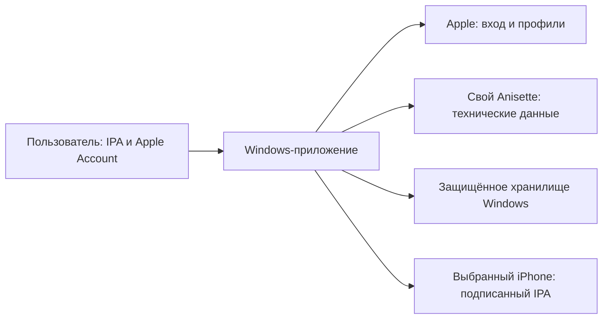

# iReSign: первая версия и порядок работы

Рабочее название изменено с LocalSign на iReSign 12 ноября 2026. Идентификатор приложения — `dev.remotevoice.iresign`; пространство Windows Credential Manager — `dev.remotevoice.iresign.v1`. Записи прежнего прототипа LocalSign этой сборкой не читаются.

Статус: реализация первого Windows-прототипа. Исходники RemoteVoice и его текущие обязательства сохраняются. Автопродление реализовано в прототипе; реальный цикл на iPhone ещё не подтверждён.

## Цель

Сделать Windows-утилиту для подписи и установки выбранного пользователем IPA на его iPhone. Добавить автоматическое продление и подготовить продукт к рассмотрению Microsoft Store. Утверждение о принятии магазином возможно только после фактического решения Microsoft.

## Основа

- iloader, коммит `80142ff82fc3dfa7312d77ea6151b4d20090151b`, версия в исходниках `2.3.6`.
- Windows x64, Tauri 2, Rust, React и TypeScript. Сборка Windows-утилиты выполняется на Windows; Xcode нужен для самостоятельной сборки iOS-приложений.
- Сохранить полезные модули устройства, подписи и установки. Существующая реализация использует `idevice 0.1.68` и `isideload 0.4.4` по Cargo.lock.
- В этой версии код приложения лицензирован MIT. Сохранить уведомление автора и проверить лицензии зависимостей. Название, иконки и другие материалы iloader имеют отдельные условия; собственное оформление создаётся отдельно.
- Первые 13 снимков и 6 дополнительных файлов закреплённой версии хранятся в `.harness/evidence/signing-utility/upstream/`. Собственный минимальный прототип находится в `signer/app/`; это не полная копия интерфейса и всех функций iloader.

## Требования

| ID | Требование | Условие проверки |
|---|---|---|
| REQ-008 | Windows 11 x64 обнаруживает доступный iPhone по USB и позволяет явно выбрать устройство | Показано реальное устройство; при отсутствии драйвера или доверия объясняется конкретный следующий шаг |
| REQ-009 | Пользователь выбирает локальный IPA, видит имя приложения и подтверждает установку | Корректный IPA разобран до подписи; повреждённый архив и опасные пути внутри архива отклоняются |
| REQ-010 | Подписать и установить IPA через Apple Account пользователя | Наша идентифицированная сборка устанавливает RemoteVoice; результат проверен на физическом iPhone, включая запуск |
| REQ-011 | Контролировать обработку учётных данных и секретов | Пароли, коды, токены и ключи отсутствуют в логах и Git; сохранение выключено по умолчанию; секретные материалы не попадают в обычные файлы при ошибке защищённого хранилища |
| REQ-012 | Использовать свой Anisette-сервис и документировать реальные сетевые назначения | Проверены обращения к выбранному сервису и Apple; установлено, какие поля и данные передаются; учётные данные Apple не поступают на Anisette или сервер издателя |
| REQ-013 | Автоматически продлевать выбранные приложения на Windows при включённом ноутбуке и доступном iPhone | Зарегистрирован реальный успешный цикл продления; видны срок профиля, доступность устройства, результат и необходимость повторного входа, если сессия истекла |
| REQ-014 | Подготовить Windows-продукт к подаче в Microsoft Store | Рабочий пакет, собственное оформление, лицензии, политика конфиденциальности, описание зависимостей и воспроизводимые инструкции для проверки; готовность пакета отделена от принятия Microsoft |

## Первая демонстрируемая версия

1. Проверка доступности Apple Mobile Device Support/usbmuxd и защищённого хранилища Windows.
2. Выбор подключённого iPhone по USB.
3. Выбор локального IPA; отображение имени, bundle ID и версии.
4. Вход и подтверждение 2FA выполняет пользователь в приложении.
5. Подпись и установка с реальными этапами и понятной ошибкой при сбое.
6. Проверка установленного приложения на устройстве и отображение срока профиля.

Первая веха — запуск RemoteVoice после установки именно нашей Windows-сборкой. Макет интерфейса, успешная компиляция и сообщение «операция начата» эту веху не закрывают.

## Автопродление в текущей сборке

Реализован планировщик для явно выбранных приложений. Он не заменяет ручную установку и не скрывает неизвестный результат.

- Пользователь добавляет текущее приложение после выбора IPA и iPhone. Копия IPA сохраняется в каталоге данных приложения; перед каждым продлением SHA-256 сверяется с одобренным значением.
- Список отслеживаемых приложений хранится в `renewal.json` в каталоге данных: bundle ID, имя и версия, UDID, SHA-256, срок профиля и фиксированный код последнего результата. Паролей и токенов в файле нет.
- Планировщик работает, пока запущено приложение. Он проверяет срок профиля через Apple и наличие iPhone по USB. По умолчанию продление запускается за 48 часов до окончания профиля, интервал проверки — 15 минут; значения настраиваются.
- Продление — это повторная подпись и установка сохранённого IPA через тот же журнал эффектов, что и ручная установка. Неизвестный результат блокирует повтор до проверки пользователем.
- Для работы после перезапуска сессию Apple Account можно явно сохранить в Windows Credential Manager: только техническая сессия, не пароль. Без сохранённой сессии после перезапуска требуется новый вход.
- Автозапуск iReSign при входе в Windows — отдельный переключатель. Он пишет только значение `iReSign` в `HKCU\Software\Microsoft\Windows\CurrentVersion\Run` и запускает приложение свёрнутым.
- Ограничения: только USB; приложение должно быть запущено; срок профиля берётся из ответа Apple; реальный успешный цикл на физическом iPhone не подтверждён, потому что нет рабочего Apple Account. Бесплатный профиль остаётся семидневным.

Проверено локально: 39 Rust-тестов, Clippy с `-D warnings`, TypeScript/Vite build, встроенный frontend, разбор RemoteVoice IPA, запись и чтение фиктивной сессии в реальном Windows Credential Manager с последующей очисткой, запуск окна приложения. Вход, подпись, установка и реальное продление не выполнялись.

## Целевые границы данных

Это проектируемый поток; сетевые запросы зависимостей ещё предстоит проверить на исполнении.

- Исходники и CI не содержат пользовательских учётных данных. GitHub собирает Windows-пакет без Apple Account пользователя.
- Пароль и код 2FA используются в памяти. Сохранение пароля требует отдельного выбора пользователя; по умолчанию выключено.
- Секреты подписи и сессий хранятся через Windows Credential Manager в отдельном пространстве имён. При ошибке хранилища приложение прекращает зависимую операцию; переход на открытые файлы исключён.
- Диагностика содержит этапы и коды ошибок. Перед выводом и экспортом исключаются пароль, код, токены, ключи и лишние идентификаторы устройства.
- Собственный Anisette не заменяет Apple Account. Для сервиса нужны отдельная настройка, доступность и проверка реальных полей запросов.
- Обновления исходного iloader из его репозитория в наш продукт не переносятся. Для публикации в Store сначала проектируется обновление через Store; иной канал проверяется и согласуется отдельно.
- Автоматическое удаление сертификатов, App ID, доверия устройства и изменение настроек безопасности не входит в первую версию.

## Найденные места, требующие изменения

1. `src-tauri/src/secure_storage.rs`: при недоступности keyring исходный код создаёт `FsStorage`. Для нашей версии требуется безопасное завершение операции либо отдельно проверенное защищённое хранение.
2. `src-tauri/tauri.conf.json`: задан сервер обновлений iloader и `csp: null`. Для своей программы нужны собственная идентичность, подходящая CSP и проверенная политика обновлений.
3. `src-tauri/src/logging.rs`: произвольные поля событий передаются во frontend. Требуется централизованная обработка секретных значений и проверка сообщений зависимостей.
4. `src-tauri/src/device.rs`: ошибки содержат UDID в выводе. Для пользовательской диагностики лишний идентификатор требуется убрать или скрыть.
5. Ранее выполненное исследование `isideload 0.4.3` не доказывает поведение выбранного здесь `isideload 0.4.4`. Новая версия и другие зависимости должны быть проверены отдельно.

Эти выводы получены чтением конкретного исходного кода. Полный аудит, соответствие готовому бинарнику и отсутствие утечек не установлены.

## Вехи

| Этап | Результат | Статус |
|---|---|---|
| 1. Основа и требования | Закреплённый исходник, лицензии, границы данных и первый сценарий | Подготовлено |
| 2. Собственная сборка | Минимальный Windows-прототип с отдельной идентичностью, защищённым хранением и адресом своего Anisette | EXE собран; компонентные проверки и запуск без учётных данных выполнены. Полный runtime-аудит и GUI-сценарий установки остаются |
| 3. Установка на iPhone | RemoteVoice подписан, установлен и запущен нашей сборкой | Запланировано; нужен рабочий Apple Account |
| 4. Продление | Реализовать автопродление на Windows и проверить первый цикл | Прототип реализован: список приложений, планировщик, срок профиля, сохранение сессии, автозапуск, интерфейс и журнал. Реальный успешный цикл не подтверждён |
| 5. Microsoft Store | Проверить совместимость упаковки и правил; подготовить пакет и материалы | Запланировано |

Пользователь выбрал автопродление на Windows при включённом ноутбуке и доступном iPhone. Это отдельная функция Windows-продукта. Первый цикл проверяется по USB; обнаружение и продление по Wi-Fi допускаются только после проверки поддерживаемого соединения и настроек устройства.

Автопродление включается для конкретных выбранных приложений. Приложение проверяет срок реального профиля, доступность устройства и сессии, запускает продление заранее и показывает результат. Секреты сохранённой сессии защищены системным хранилищем. Если требуется новый вход или 2FA, пользователь получает понятное состояние; полностью бессрочная работа без участия пользователя не обещается. Настройка автозапуска и фонового выполнения — явный выбор в продукте.

## Действующие ограничения и проверки перед выпуском

- Регистрация отдельного Apple Account ранее завершилась общим отказом Apple; успешное создание и вход пока не подтверждены. Это препятствует проверке реальной подписи, но не сборке Windows-прототипа.
- Для сборки использованы имеющиеся C++ Build Tools 18.5 и Node.js 24.14.1. Rust 1.99.1, Cargo, rustfmt и Clippy доступны в системе; зависимости закреплены Cargo.lock и package-lock.json. Bun не требуется.
- Для Store надо проверить зависимость от Apple-драйверов и служб, возможность проверки с физическим iPhone и условия использования сторонних сервисов/API. Правила Microsoft предусматривают отдельное рассмотрение зависимостей от немайкрософтовских драйверов/служб; разрешение для нашего продукта не установлено.
- По состоянию на 8 октября 2026 используется действующая редакция правил Store 7.19. Редакция 7.20 вступает в силу 22 октября 2026; перед подачей перечитать действующие требования.
- Бесплатный профиль Apple ограничен семью днями. Возможность своего форка и автопродления не меняет это ограничение.
- Собственная Windows-сборка и прототип автопродления созданы. Локальный Anisette v3 поднят в WSL и прошёл проверку `--check-anisette`; для публичного продукта нужен собственный или явно лицензированный сервис, потому что у использованного проекта лицензия не заявлена. Реальный цикл подписи и продления не проверен.
- Первая холодная сборка `aws-lc-sys` завершилась ошибкой; повторная сборка той же версии и последующие проверки прошли. Причина первого сбоя не установлена. До выпуска нужен чистый воспроизводимый CI-build.

## Следующая задача

Настроить собственный Anisette, проверить фактические сети/данные и поведение WebView при входе. Локальный Anisette уже поднят и проверен; следующий шаг — вход с рабочим Apple Account и iPhone по USB. Подписать, установить и запустить RemoteVoice этой сборкой, сохранить сессию и добавить приложение в автопродление. Затем подтвердить реальный срок профиля и первый цикл продления; после этого готовить Store-пакет. Пошаговый порядок — [FIRST-RUN.md](FIRST-RUN.md), локальный сервис — [ANISETTE.md](ANISETTE.md).

## Источники

- [iloader, закреплённая версия](https://github.com/nab138/iloader/tree/80142ff82fc3dfa7312d77ea6151b4d20090151b)
- [MIT License](https://github.com/nab138/iloader/blob/80142ff82fc3dfa7312d77ea6151b4d20090151b/LICENSE)
- [Условия оформления iloader](https://github.com/nab138/iloader/blob/80142ff82fc3dfa7312d77ea6151b4d20090151b/LICENSE-BRANDING)
- [Microsoft Store: правила 7.19](https://learn.microsoft.com/en-us/windows/apps/publish/store-policy-archive/store-policy-7-19)
- [Microsoft Store: правила 7.20 и дата вступления](https://learn.microsoft.com/en-us/windows/apps/publish/store-policies)
- [Публикация Windows-приложения](https://learn.microsoft.com/en-us/windows/apps/distribute-through-store/how-to-distribute-your-win32-app-through-microsoft-store)
- [Собственный Anisette-сервер](https://github.com/Dadoum/anisette-v3-server)
- [Ограничения бесплатной команды Apple](https://developer.apple.com/help/account/basics/about-your-developer-account/)
